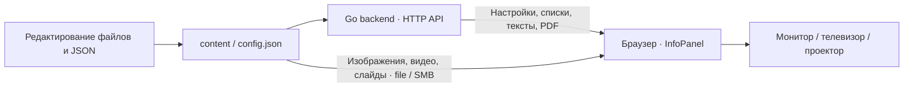
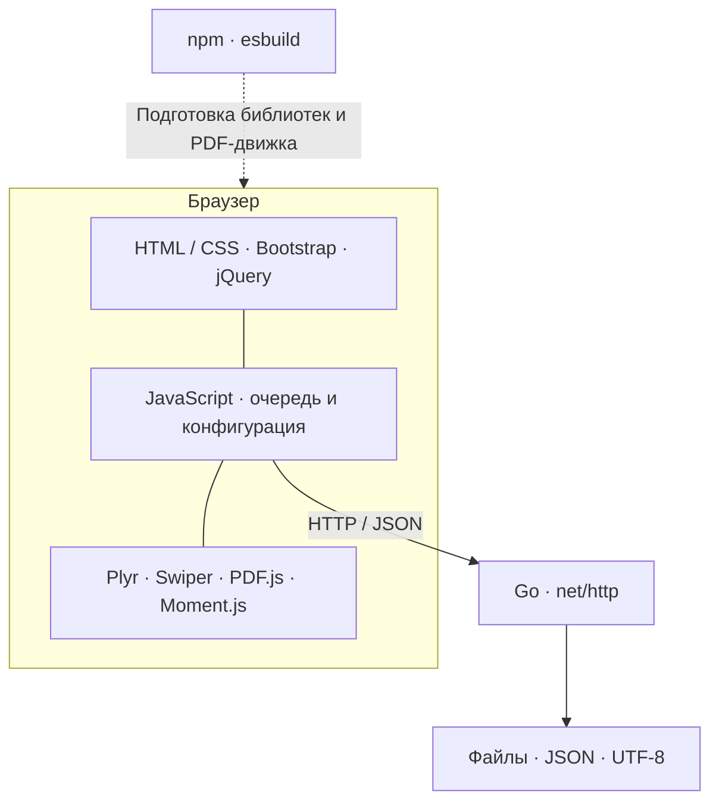

# InfoPanel

**Информационная панель для автономной работы в локальных сетях без доступа в интернет.**

Основная цель проекта — организовать показ и централизованное хранение контента в локальной сети, где нет доступа в интернет. Страница, библиотеки, настройки и материалы находятся внутри локальной инфраструктуры; подключение к облачным сервисам и загрузка пакетов на компьютерах показа не требуются.

InfoPanel показывает объявления, изображения, видео, презентации, PDF и дни рождения на одном или нескольких экранах. Поддерживается также запуск на отдельном ПК. Для управления используются обычные файлы и папки, для настройки — JSON. Изменения подхватываются во время работы, без перезагрузки страницы.

Приложение рассчитано на непрерывную работу на Windows. Архитектура разделяет получение данных и отображение, управляет асинхронным воспроизведением и жизненным циклом компонентов, предусматривает восстановление после ошибок.

[Архитектура](docs/architecture.md) · [Установка и использование](docs/usage.md) · [Настройки](docs/configuration.md) · [API](docs/api.md) · [Разработка](docs/development.md)

## Как устроен проект

Backend отвечает за доступ к данным, клиент — за порядок и показ. База данных и административная панель не требуются. Изображения и видео читаются браузером из каталога проекта; PDF доставляется через API и отрисовывается в браузере.

### Технологии

| Слой | Технологии | Назначение |
| --- | --- | --- |
| Интерфейс | HTML, CSS, JavaScript, Bootstrap, jQuery | Компоновка экрана, оформление и работа с DOM |
| Управление показом | JavaScript-классы, Promise, async/await | Очередь, модули контента, независимая нижняя строка |
| Медиа | Plyr, Swiper, PDF.js, Moment.js | Видео, слайды, страницы PDF и календарные расчеты |
| Backend | Go, стандартная библиотека `net/http`, `io/fs`, `os` | HTTP API, чтение JSON и файлов, выдача PDF |
| Хранение | Файловая система, JSON, текстовые файлы | Контент и настройки без базы данных |
| Разработка | npm lock-файл, esbuild, Node.js Test Runner, Go testing | Зависимости, сборка PDF-движка и проверки |

Готовые библиотеки поставляются в `node_modules.rar`, сервер и PDF-движок включены в проект. Node.js и Go нужны только для разработки и пересборки.

### Архитектурные решения

- **Модули с общим протоколом.** Каждый тип основного контента получает данные, создает задания и выполняет асинхронный `show()`. Роутер управляет переходами между заданиями.
- **Два независимых потока показа.** `ContentRouter` последовательно воспроизводит основной контент; `LineRouter` обновляет поздравления и ближайшие дни рождения внизу экрана.
- **Явный жизненный цикл.** Promise показа завершается после освобождения компонентов и таймеров. Ошибка одного элемента не должна останавливать очередь.
- **Конфигурация во время работы.** Параметры проверяются отдельно; ошибочное значение заменяется стандартным, корректные продолжают применяться.
- **Восстановление после сбоев.** Тайм-ауты запросов, контроль прогресса видео и слайдов, индикатор ошибок с TTL, повторное получение данных на следующих циклах.
- **Поставка для файлового запуска.** PDF.js собирается в один подключаемый скрипт со встроенными ресурсами; документ разбирается в Web Worker.

Подробности, схема модулей, последовательность воспроизведения и компромиссы описаны в [архитектуре](docs/architecture.md).

## Как выглядит

Скриншоты интерфейса

## Возможности

| Контент | Как подготовить | Как показывается |
| --- | --- | --- |
| Изображения | Файлы в `content/imgs` | По одному с заданным интервалом |
| Видео | Файлы в `content/video` | До завершения ролика, с контролем зависания |
| Презентации | Папка с изображениями и необязательным `title.txt` | Последовательность слайдов с эффектами Swiper |
| PDF | Документы в `content/pdf` | Все страницы по порядку, с интервалом на страницу |
| Объявления | Текстовые файлы в `content/text` | Текст с разрешенной разметкой и подбором шрифта |
| Дни рождения | `content/birthday/birthday.txt` | Основной список, поздравления сегодня и ближайшие даты в строке |

Дополнительно: логотип, календарь, часы, смена расположения колонок и необязательный эффект «Матрица». При отсутствии основного контента или доступной конфигурации отображается заставка с часами.

## Проверка и границы проекта

В репозитории есть автоматические проверки очереди, таймеров воспроизведения, запросов, настроек, путей и календарных расчетов, а также Go-тесты API и выдачи PDF. Отдельная браузерная страница проверяет работу настоящего Swiper. Команды и границы этих проверок — в [руководстве разработчика](docs/development.md).

Проект рассчитан на доверенную локальную среду: авторизации в API нет. Экраны работают независимо, синхронизация показа между ними не реализована. Совместимость файлового запуска, сетевых папок, кодеков и политики доступа браузера проверяется на целевых компьютерах. Удаленное администрирование, централизованное наблюдение и расписания по времени суток пока не реализованы.
