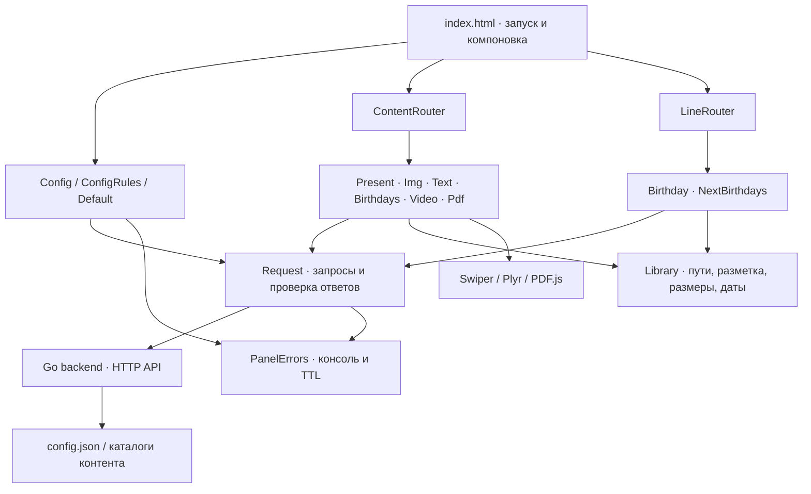
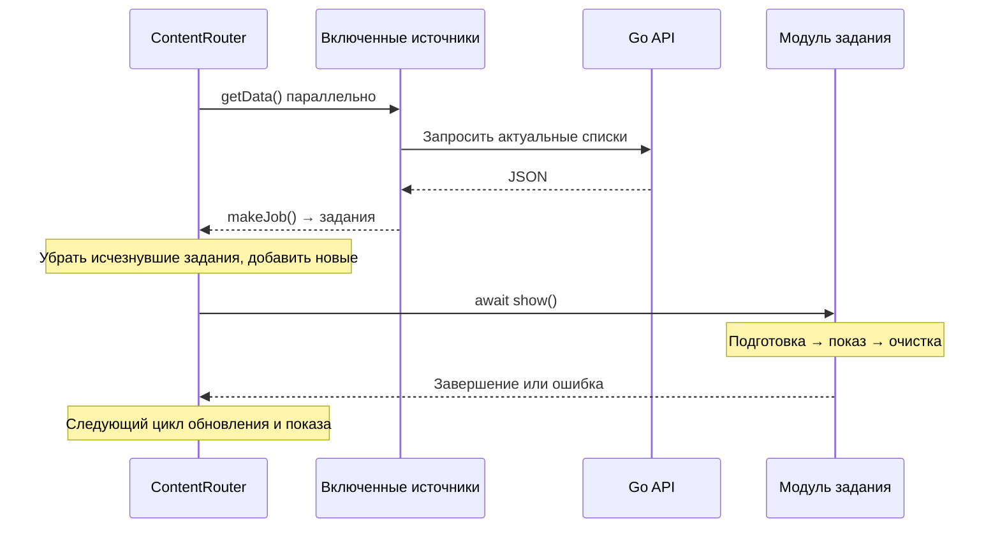

# Архитектура InfoPanel

[← README](../README.md) · [Установка и использование](usage.md) · [Настройки](configuration.md) · [API](api.md) · [Разработка](development.md)

## Задача и границы

Основная задача InfoPanel — обеспечить работу информационных экранов в локальной сети без доступа в интернет, с хранением контента в одном месте. Сервер, страница, браузерные библиотеки и материалы размещаются внутри локальной инфраструктуры. Для установки готового проекта и его повседневной работы не нужны облачные сервисы, внешние CDN и загрузка пакетов на компьютерах показа. Запуск на отдельном ПК также поддерживается.

Для такого развертывания выбран файловый способ управления: оператор меняет содержимое общей папки и JSON, а браузеры самостоятельно обновляют очередь без ручного переключения и перезагрузки страницы. Готовые библиотеки поставляются в архиве, сервер — в виде исполняемого файла.

Система состоит из браузерного клиента и Go-backend. Сервер читает данные, клиент определяет порядок воспроизведения и управляет интерфейсом. Состояние очередей и ошибок хранится в памяти страницы. Базы данных, пользовательских сессий и серверного планировщика нет.

## Компоненты и зависимости

Стрелки показывают основные связи, а не строгую изоляцию слоев: модули обращаются к глобальной конфигурации и DOM, роутеры — к общим функциям заставки. Это обычные подключаемые скрипты, без ES-модулей и контейнера зависимостей. Порядок подключения задан в `index.html`.

| Компонент | Ответственность | Исходники |
| --- | --- | --- |
| `Config`, `ConfigRules`, `Default` | Загрузка, проверка, подстановка значений, применение оформления | [config/](../assets/js/config/) |
| `Themes` | Загрузка локальной темы, защита от устаревших загрузок, возврат к classic и чтение CSS-переменных | [themes.js](../assets/js/config/themes.js) |
| `Request` | Тайм-ауты API, проверка структуры ответов, фильтрация списков | [request.js](../assets/js/request.js) |
| `ContentRouter` | Обновление заданий и последовательное воспроизведение | [contentRouter.js](../assets/js/content/contentRouter.js) |
| `LineRouter` | Обновление и смена нижних строк | [lineRouter.js](../assets/js/lines/lineRouter.js) |
| Модули | Подготовка данных и показ определенного типа контента | [content/modules/](../assets/js/content/modules/), [lines/modules/](../assets/js/lines/modules/) |
| `Library` | Общие операции с текстом, путями, размерами и датами | [library.js](../assets/js/library.js) |
| `PanelErrors` | Учет ошибок по ключу, TTL и индикатор | [errors.js](../assets/js/errors.js) |
| Go-backend | Чтение конфигурации и контента, реализация API | [main.go](../backend/src/main.go), [pdf.go](../backend/src/pdf.go) |

Часы и календарь обновляются отдельно. `Matrix` реализует необязательный эффект перехода. Модуль `Holiday` присутствует в исходниках, но в текущий список источников `LineRouter` не включен.

## Протокол модуля основного контента

В JavaScript нет формального интерфейса, но роутер ожидает общий набор методов:

| Член | Договоренность |
| --- | --- |
| `static name` | Имя источника и суффикс настройки `with_<name>` |
| `static initContent()` | Создать контейнеры отображения |
| `static getData()` | Вернуть данные для подготовки заданий |
| `static makeJob(data)` | Создать `{ h, cl }`: идентификатор и экземпляр модуля |
| `async show()` | Завершиться после показа и очистки ресурсов; отклониться при ошибке |

`h` связывает полученные задания с уже имеющимися. Большинство модулей использует числовой хеш, PDF — сериализованную пару имени модуля и файла. Это механизм сравнения элементов очереди, а не контроль целостности файлов.

У модулей нижней строки другой протокол: `makeLine()`, `show()` и `hide()`. Продолжительность и смену строк задает `LineRouter`.

## Цикл воспроизведения

При первом обновлении задания перемешиваются, затем воспроизводятся по кругу. Новые задания добавляются перед сохраненными. Перед каждым показом списки источников перечитываются; запросы к разным источникам выполняются параллельно. Отключенные модули не опрашиваются и исключаются при следующем обновлении очереди. Уже начавшийся показ заканчивается своим обычным путем.

`ContentRouter.start()` защищен от повторного запуска. Роутер ожидает `show()` и сам выбирает следующий элемент: модуль не запускает очередь рекурсивно. Компоненты Plyr и Swiper, обработчики событий и таймеры принадлежат конкретному показу и очищаются после него.

Если очередь пуста, цикл делает паузу `jobs_restart_timeOut` и повторяет проверку. Заставка определяется наличием основного контента и доступностью конфигурации: существование только нижних строк не удерживает основной экран открытым.

## Данные и обновление конфигурации

Адрес API известен клиенту до первого запроса: он берется из `config/client.js`. Одноименные поля в серверном JSON задают адрес прослушивания сервера. Это разные роли, поэтому для сетевого запуска настраиваются оба файла.

Клиент периодически получает `/config`, проверяет параметры через `ConfigRules` и применяет их. Значения по умолчанию сосредоточены в `Default`; базовые CSS-переменные также заданы в `common.css` для первого кадра и возврата к classic. `Themes` загружает локальный stylesheet неактивным, затем применяет его и снимает предыдущий. CSS-переменные темы считываются без прежних JSON-поправок; явные параметры оформления применяются поверх них. Устаревшие результаты параллельных загрузок отбрасываются. Подробности — в [руководстве по кастомизации](customization.md). Ошибка отдельного параметра не отменяет остальные. При ошибке всего запроса конфигурация считается недоступной и показываются часы; последняя успешная конфигурация целиком не кэшируется.

Backend перечитывает JSON на каждый запрос. Это упрощает применение изменений, но не дает единого снимка данных для нескольких параллельных запросов. Изменение IP или порта требует перезапуска процесса, поскольку слушающий сокет создается один раз.

## Доставка медиа и PDF

Обычные изображения, видео, слайды и логотип браузер читает через относительные файловые адреса. При запуске из общей папки это доступ через SMB. Backend возвращает имена файлов и содержимое текстовых данных; статический сайт он не раздает.

PDF использует отдельный путь:

Движок загружается при первом показе PDF. Сборка в `scripts/build-pdf.cjs` включает код worker, карты символов, стандартные шрифты и WASM-ресурсы в один скрипт. Worker создается из Blob; ресурсы передаются из встроенного набора. Это позволяет не загружать ES-модули и вспомогательные ресурсы PDF.js отдельными запросами со страницы `file://`.

Документ скачивается целиком в память, затем страницы последовательно рисуются на canvas. Масштаб учитывает размер области и плотность пикселей до 2; длинная сторона ограничена примерно 3840 пикселями. Пока следующая страница рисуется, предыдущая остается в контейнере. Backend ограничивает документ 100 МиБ, клиент ограничивает ожидание скачивания, открытия, получения и отрисовки страницы 30 секундами на операцию. После показа документ и worker освобождаются. Между показами кэша документов нет.

## Ошибки и восстановление

| Ситуация | Поведение |
| --- | --- |
| Тайм-аут, HTTP-ошибка, неверная структура ответа | Данные запроса пропускаются; повторный опрос позволяет восстановиться |
| Некорректная запись дня рождения | Запись исключается, остальные сохраняются |
| Некорректный параметр | Применяется стандартное значение, регистрируется ошибка |
| Видео не стартовало за 5 секунд | Показ завершается ошибкой, очередь продолжается |
| Видео не продвигается | Через `video_stall_timeout` ролик пропускается |
| Слайды не переключаются | Проверка прогресса завершает показ с ошибкой; скрытая вкладка учитывается отдельно |
| Ошибка PDF | Документ пропускается, ресурсы освобождаются |

`PanelErrors` хранит ошибки в памяти по ключам. Повтор продлевает TTL, одинаковые сообщения в консоли ограничиваются по частоте. Значок исчезает после истечения срока всех ошибок, а не сразу после успешного запроса.

## Компромиссы и дальнейшее развитие

Файловая архитектура сокращает инфраструктуру и позволяет управлять содержимым обычными средствами Windows. Ее ограничения:

- Файловый запуск зависит от доступа к общей папке и политики браузера для запросов к локальной сети.
- Опрос перед каждым показом связывает скорость переключения с самым медленным источником. Фоновое обновление и сохранение последнего успешного списка — возможное развитие.
- Модули связаны глобальными классами и DOM; модульная сборка и явная передача зависимостей упростили бы изолированное тестирование.
- Некоторые ошибки чтения backend возвращает как пустой список. Более точные статусы помогли бы отличать отсутствие контента от проблем доступа.
- Для CSS-фонов изображений и слайдов нет отдельного подтверждения успешной загрузки.
- PDF целиком размещается в памяти, а длинный документ занимает очередь до последней страницы.
- API не требует авторизации. Удаленное администрирование, синхронизация экранов и постоянный журнал событий отсутствуют.

Это границы текущей реализации, а не реализованные возможности или обещанный план работ.
