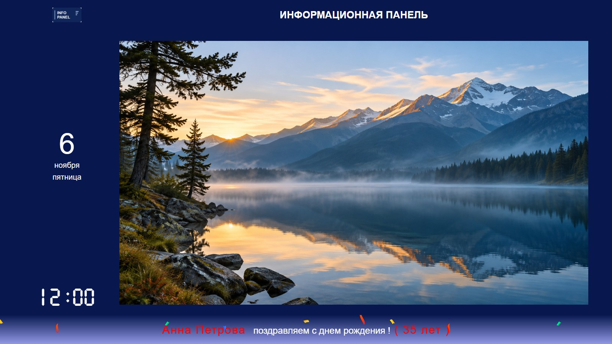
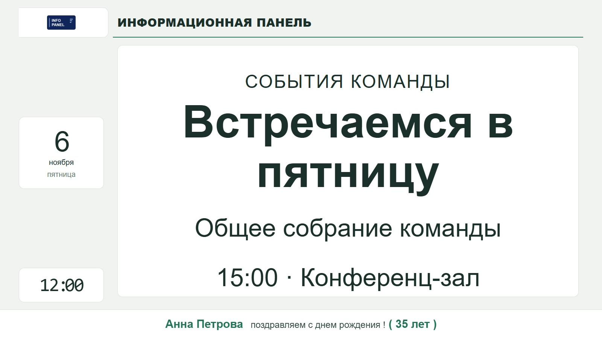
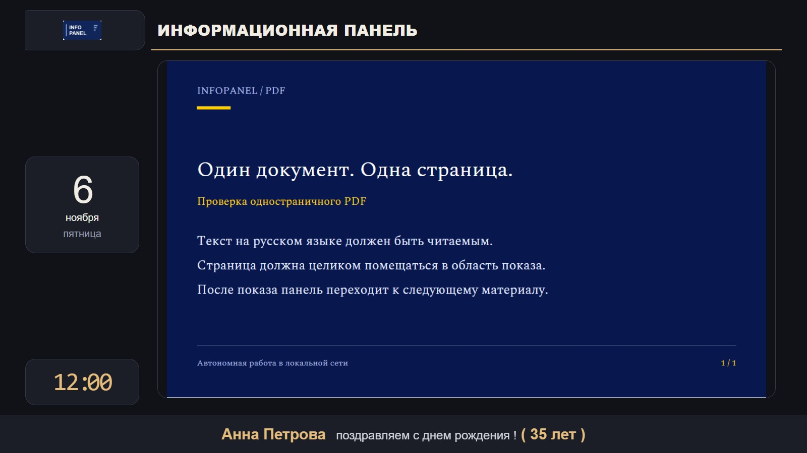
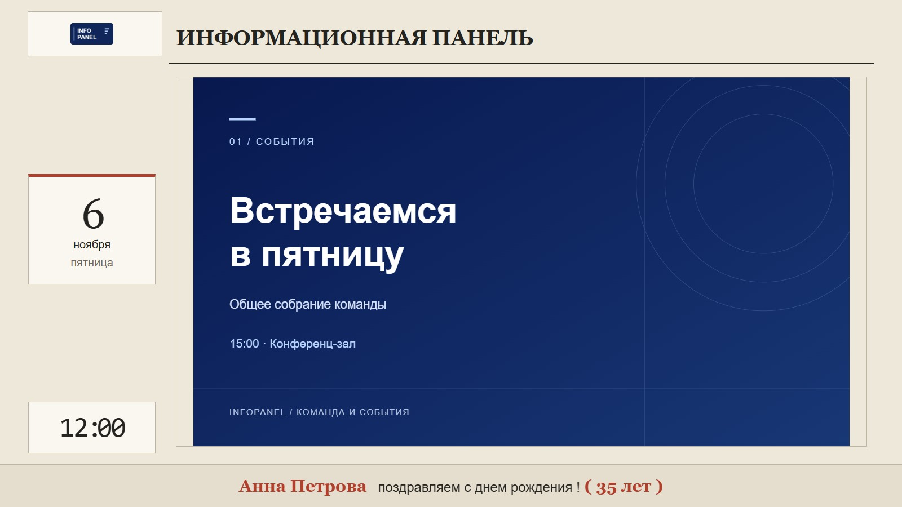
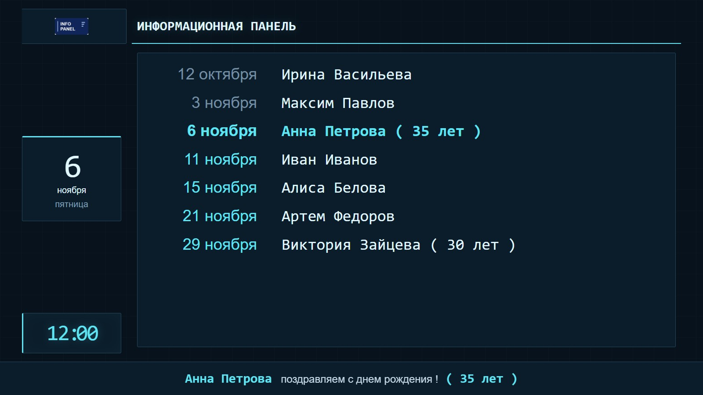

# Кастомизация

[← README](../README.md) · [Установка и использование](usage.md) · [Настройки](configuration.md)

Панель можно настроить под свой экран и оформление организации: выбрать готовую тему, изменить отдельные цвета и размеры, заменить логотип и шрифты или добавить собственную тему. Все ресурсы остаются локальными.

## Выбор темы

Откройте `backend/config.json` в Блокноте и добавьте или измените свойство внутри существующего объекта:

```json
"theme": "hi-tech"
```

Сохраните файл. При следующем обновлении конфигурации панель применит оформление без перезагрузки страницы и прерывания текущего показа.

| Имя | Оформление | Актуальный пример |
| --- | --- | --- |
| `classic` | Исходный синий фон, расположение блоков и оформление; обновлены только шрифты. Используется по умолчанию | [](images/classic-images.jpg) |
| `minimal` | Светлая поверхность, зеленые акценты, простая типографика и мягкие углы | [](images/minimal-text.jpg) |
| `midnight` | Графитовый фон, теплые золотистые акценты и спокойные карточки | [](images/midnight-pdf.jpg) |
| `editorial` | Бумажный фон, крупная шапка с засечками, строгие линии и красный акцент | [](images/editorial-presentation.jpg) |
| `hi-tech` | Сине-черный фон с тонкой сеткой, циан, геометрические блоки и цифровые часы | [](images/hi-tech-birthdays.jpg) |

Скриншоты сделаны на текущем демонстрационном контенте; для каждого примера включен соответствующий блок.

Темы меняют оформление шапки, календаря, часов, текстов, дней рождения, нижней строки и обрамления медиа. Основная компоновка и порядок воспроизведения остаются общими. Изображения и страницы PDF сохраняют собственные цвета: тема не перекрашивает содержимое файлов.

## Как сочетаются тема и настройки

Приоритет: **базовые стили → выбранная тема → явно заданные параметры JSON**. Например, `"header_color": "#ffcc00"` задаст желтый заголовок поверх любой темы. При удалении этой настройки вернется цвет выбранной темы.

В старом рабочем JSON могут быть записаны почти все цвета и размеры. Чтобы увидеть оформление темы целиком, удалите ненужные параметры оформления, перечисленные в [справочнике](configuration.md#оформление). Адрес сервера, пути и переключатели блоков сохраняйте. В новом `config.json.example` фиксированная палитра уже убрана.

Если `theme` отсутствует, используется `classic`. Если файл темы отсутствует или не загрузился за 5 секунд, применяется базовое оформление `classic` и регистрируется ошибка. При следующих опросах загрузка выбранной темы повторяется. Загрузившийся файл не перечитывается при каждом опросе: после редактирования CSS уже активной темы перезагрузите страницу.

## Логотип, текст и шрифты

- Замените `content/logo.png` своим PNG-логотипом. Его ширина задается через `logo_width`.
- Измените `header_text` в рабочем JSON, чтобы задать название организации или экрана.
- Цвета, размеры и отступы перечислены в [настройках оформления](configuration.md#оформление); их можно задать поверх любой темы.
- Для собственных шрифтов положите файлы в папку темы, объявите `@font-face` в ее CSS и используйте переменные `--font_body`, `--font_header`, `--font_display`, `--font_clock`. Внешняя загрузка шрифтов не нужна.

Изменение темы и JSON-параметров применяется во время работы. После замены логотипа, шрифтов или CSS активной темы перезагрузите страницу.

## Добавление своей темы

1. Откройте `assets/themes` и скопируйте папку `template`.
2. Переименуйте копию, например в `my-theme`. Имя начинается со строчной латинской буквы, содержит только строчные латинские буквы, цифры, дефис и подчеркивание; длина — до 48 символов.
3. Откройте `theme.css` внутри новой папки и измените CSS-переменные. Начните с фона, текста и акцентов.
4. Укажите `"theme": "my-theme"` в рабочем JSON и сохраните его.

```text
assets/themes/my-theme/
├── theme.css
├── fonts/       # необязательно
└── images/      # необязательно
```

Регистрация в JavaScript и пересборка не нужны. Используйте локальные шрифты и изображения с путями относительно `theme.css`, например `url("images/background.png")`. Внешние URL, CDN и удаленные шрифты нарушают автономность проекта.

### Переменные темы

Все параметры из раздела [«Оформление»](configuration.md#оформление) доступны как CSS-переменные с префиксом `--`: `background_color` → `--background_color`. Дополнительно доступны:

| Переменные | Назначение |
| --- | --- |
| `--panel_surface`, `--panel_border`, `--panel_accent`, `--panel_muted` | Фон карточек, граница, акцент и вторичный текст |
| `--panel_radius` | Радиус углов карточек и области медиа |
| `--font_body`, `--font_header`, `--font_display`, `--font_clock` | Основной текст, шапка, крупные надписи и цифровые часы |
| `--content_text_color`, `--content_text_background_color` | Текст и фон объявлений |
| `--content_birthdays_name_color`, `--content_birthdays_date_color` | Имена и даты основного списка |
| `--content_birthdays_date_prev_color` | Прошедшие даты |
| `--content_birthdays_date_today_color`, `--content_birthdays_name_today_color` | Сегодняшние даты и имена |
| `--birthday_name_color` | Выделенное имя в поздравлении |

Для чтения размеров из JavaScript задавайте обычные CSS-длины, например `--info_line_height: 76px`. Файл должен содержать корректный CSS: браузер может успешно загрузить файл с ошибочными правилами и проигнорировать их. Загрузчик проверяет доступность файла, а не правильность каждого селектора.

### Более глубокое оформление

У корневого элемента есть атрибут `data-theme` с именем активной темы. Основные точки оформления: `#div_header`, `#div_logo`, `#div_calendar`, `#div_clock`, `#div_content_area`, `#div_info_line`, `#div_text`, `#div_birthdays`, `#div_present_title`.

```css
html[data-theme="my-theme"] #div_header {
  border-bottom: 3px solid var(--panel_accent);
}
```

Общие детали новых тем находятся в `assets/themes/base.css`; у `classic` собственные правила в `classic/theme.css`. Не переопределяйте классы скрытия `d-none`, размеры внутренних canvas, трансформации слайдов и анимации нижней строки: они участвуют в работе плеера. Проверьте читаемость издалека, размещение нижней строки и показ изображений и PDF целиком.
