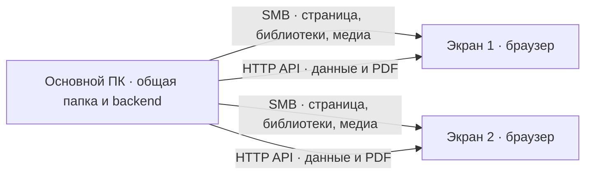

# Установка и использование InfoPanel

[← README](../README.md) · [Настройки](configuration.md) · [API](api.md)

Основной сценарий InfoPanel — экраны в локальной сети без доступа в интернет, использующие одно хранилище контента. Ниже описан первый запуск на одном компьютере; затем — подключение остальных экранов к общей папке и серверу внутри сети.

## Подготовка и первый запуск

Для работы нужны Windows, современный браузер и полная папка проекта. **Интернет, установка пакетов, Node.js и Go для запуска не требуются.** Все необходимые библиотеки лежат в `node_modules.rar`, готовый сервер — в папке `backend`, средство просмотра PDF уже включено в проект.

Если браузер и средство распаковки архивов нельзя устанавливать на целевой компьютер, подготовьте папку на другом ПК: извлеките проект и `node_modules.rar`, затем перенесите все файлы на флешке. На компьютере показа достаточно уже установленного подходящего браузера. Поддержку PDF и видео проверьте в нем до постоянного использования.

### Шаг 1. Скопируйте файлы

Скопируйте весь проект в постоянную папку, например `C:\InfoPanel`. Если он находится в архиве, сначала извлеките все содержимое. Откройте полученную папку в Проводнике: в ней должны быть `index.html`, `node_modules.rar`, `assets`, `backend` и `content.example`.

Не запускайте панель из окна архиватора и не переносите один `index.html` отдельно от остальных файлов.

### Шаг 2. Распакуйте библиотеки

Откройте `node_modules.rar` и выберите извлечение в папку проекта — ту, где находится `index.html`. Название действия зависит от архиватора: например, «Извлечь в текущую папку» или «Извлечь…» с выбором `C:\InfoPanel`.

После распаковки рядом с `index.html` должна появиться папка `node_modules`, а внутри нее — папки `bootstrap`, `jquery`, `moment`, `plyr` и `swiper`. Если получилось две вложенные папки `node_modules`, переместите внутреннюю на уровень рядом с `index.html`. Сам архив после распаковки для работы не нужен.

Если готовая папка `node_modules` уже перенесена с другого компьютера, пропустите этот шаг.

### Шаг 3. Подготовьте контент и настройки

1. В Проводнике включите показ расширений файлов. В Windows 11 этот пункт обычно находится в меню «Просмотреть → Показать → Расширения имен файлов», в Windows 10 — на вкладке «Вид».
2. Найдите папку `content.example`, щелкните по ней правой кнопкой мыши, выберите «Переименовать» и укажите `content`.
3. Откройте папку `backend`. Таким же способом переименуйте `config.json.example` в `config.json`: удалите только окончание `.example`. Если Windows попросит подтвердить изменение расширения, подтвердите переименование.

При повторной подготовке не заменяйте уже существующие `content` и `config.json`: в них могут находиться ваши материалы и настройки. Для первого запуска на одном ПК редактировать настройки не нужно.

### Шаг 4. Проверьте расположение файлов

Готовая папка должна выглядеть так:

```text
InfoPanel/
├── index.html
├── assets/
├── node_modules/
│   ├── bootstrap/
│   ├── jquery/
│   ├── moment/
│   ├── plyr/
│   └── swiper/
├── backend/
│   ├── backend.exe
│   └── config.json
└── content/
    ├── logo.png
    ├── imgs/
    ├── video/
    ├── text/
    ├── present/
    ├── pdf/
    └── birthday/
```

Другие файлы проекта можно оставить на месте. В `content/pdf` уже есть одностраничный и четырехстраничный PDF для проверки показа.

### Шаг 5. Запустите панель

1. Откройте папку `backend` и дважды щелкните `backend.exe`. Появится окно программы с сообщением о запуске сервера. Не закрывайте его во время работы панели. Если окно сразу исчезло, проверьте, что рядом лежит файл с точным именем `config.json`.
2. Вернитесь в папку `InfoPanel`, щелкните правой кнопкой по `index.html` и выберите «Открыть с помощью» → ваш браузер. Если HTML уже открывается в нужном браузере, достаточно двойного щелчка.
3. Подождите несколько секунд: после стартовых часов должен появиться пример контента. Для показа на весь экран нажмите F11; повторное нажатие вернет обычный вид.

Страница открывается с компьютера, а не из интернета. Сервер передает ей данные по стандартному локальному адресу `127.0.0.1:8084`. Вводить этот адрес для обычного запуска не нужно.

### Следующие запуски и остановка

После перезагрузки компьютера снова откройте `backend.exe`, затем `index.html`. Подготовку папок и распаковку повторять не требуется. Если сервер уже работает, второй экземпляр запускать не нужно. Для остановки закройте браузер с панелью и окно сервера. Для удобства можно создать на рабочем столе ярлыки этих двух файлов.

### Добавьте свои материалы

Откройте `content` и замените примеры своими файлами по правилам ниже. Чтобы изменить название в шапке, откройте `backend/config.json` через «Открыть с помощью → Блокнот», найдите `header_text` и замените только текст внутри кавычек. Сохраните файл с прежним именем `config.json`, не добавляя `.txt`. Для логотипа замените `content/logo.png` своим PNG-изображением.

## Организация контента

В `content.example` подготовлены демонстрационные объявления о встрече команды и обмене опытом, презентация `TeamEvents` из трех SVG-слайдов, карточка-изображение, логотип и два PDF. Имена и даты дней рождения вымышлены. Стандартные фотографии заменены сгенерированными изображениями озера на рассвете, современной архитектуры и оранжереи. Сценарии презентаций без заголовка, с пустым и многострочным заголовком сохранены.

```text
content/
├── logo.png
├── imgs/                  # отдельные изображения
├── video/                 # видеоролики
├── text/                  # текстовые объявления
│   └── announcement.txt
├── present/               # одна папка = одна презентация
│   └── Safety/
│       ├── 01.jpg
│       ├── 02.jpg
│       └── title.txt      # необязательно
├── pdf/                   # PDF-документы
│   ├── SinglePage.pdf     # пример на одну страницу
│   └── MultiPage.pdf      # пример на четыре страницы
└── birthday/
    └── birthday.txt
```

Пути настраиваются в `backend/config.json`. Обход каталогов не рекурсивный: подпапка в `text` не станет отдельным объявлением, а презентации читаются на один уровень ниже `present`.

Добавление и удаление файлов учитывается при следующем обновлении очереди перед показом. Текущий показ не прерывается. Списки обновляются опросом, поэтому применение изменений не мгновенное. Замену больших файлов удобнее выполнять переименованием уже полностью скопированного файла, чтобы панель не прочитала незавершенную копию.

### Изображения и видео

Поместите изображения в `imgs`, ролики — в `video`. Поддержка формата и видеокодека определяется браузером; наличие расширения в списке само по себе не гарантирует воспроизведение. Практический исходный вариант — обычные JPEG/PNG и MP4, которые нужно проверить на целевом экране.

Изображение показывается `content_img_interval` миллисекунд. Видео проигрывается до конца. Настройка `content_video_volume` задает громкость от 0 до 1; в примере конфигурации она равна 0. Браузер может запретить автоматический запуск со звуком.

Видеоплеер пропускает ролик, если запуск не начался за 5 секунд или время воспроизведения не продвигается дольше `video_stall_timeout`. Ручная пауза тоже считается отсутствием прогресса.

### Презентации

Создайте в `content/present` папку с изображениями. Ее имя идентифицирует презентацию. `title.txt` необязателен, может содержать несколько непустых строк с разрешенной разметкой. Пустой или отсутствующий заголовок не мешает показу слайдов.

`content_present_interval` задает интервал на слайд, включая последний. Эффект перехода выбирается из `flip`, `cube`, `fade`. `content_present_sort` задает порядок:

- `default` — порядок ответа backend;
- `asc` — по имени, с учетом чисел: `1.jpg`, `2.jpg`, `10.jpg`;
- `desc` — обратный порядок.

Настройка применяется со следующего показа презентации. Это презентации из изображений; файлы PowerPoint напрямую не открываются.

### PDF

PDF включен по умолчанию. Положите свои документы в `content/pdf`; после подготовки примера контента там уже находятся `SinglePage.pdf` (одна страница) и `MultiPage.pdf` (четыре страницы). Дополнительное включение в настройках не требуется.

Параметр `content_pdf_interval` задает время показа страницы (по умолчанию 10000 мс). Чтобы отключить PDF, установите `"with_pdf": false` в `backend/config.json`. Путь к папке меняется через `path_pdf`.

Каждый документ занимает одно место в очереди и показывается целиком, страница за страницей. При 10 секундах на страницу документ из 100 страниц занимает как минимум около 17 минут. Размер файла ограничен 100 МиБ. Документ скачивается через backend целиком; большой скан может потребовать заметно больше оперативной памяти, чем размер файла на диске.

Установленный PDF-просмотрщик и предварительная конвертация страниц не нужны. Техническая схема приведена в [архитектуре](architecture.md).

### Текстовые объявления

Один файл в `content/text` — одно объявление. Непустые строки отображаются вместе, с переносами. Сохраняйте файлы в UTF-8; BOM поддерживается. Пустые строки при чтении удаляются.

Пример `announcement.txt`:

```html
<b>Общее собрание</b>
Пятница, 15:00, конференц-зал
<span style="color: #ffcc00">Просьба прийти за пять минут до начала.</span>
```

Текст показывается `content_text_interval` миллисекунд, размер шрифта подбирается под область. Для очень длинного сообщения лучше подготовить несколько файлов.

### Дни рождения

Формат каждой строки `content/birthday/birthday.txt`:

```text
12.10:Иван Иванов
21.11.1990:Анна Петрова
29.02.2000:Алексей Смирнов
```

Дата допускает вид `ДД.ММ` или `ДД.ММ.ГГГГ`. Год нужен для расчета юбилея: положительного возраста, кратного пяти. Некорректные записи клиент исключает с сообщением в консоли.

Данные используются в трех местах: основной список прошедших и будущих дат, поздравление сегодня, нижняя строка ближайших дней рождения. Сегодняшние именинники исключены из строки ближайших дат. Параметр `birthday_leap_day` определяет перенос 29 февраля в невисокосном году: `less` — 28 февраля, `more` — 1 марта.

Число записей регулируют `content_birthdays_prev_count`, `content_birthdays_next_count`, `line_next_birthdays_count`. В коротком исходном списке один человек может попасть и в прошедшую, и в будущую часть основного списка.

### Разметка оформления

В объявлениях, заголовках презентаций, именах дней рождения и `header_text` разрешены теги:

`b`, `strong`, `i`, `em`, `u`, `s`, `span`, `font`, `sub`, `sup`, `small`, `big`, `br`; абзацы `p`, блоки `div`, заголовки `h1`–`h6`, списки `ul`, `ol`, `li`, `dl`, `dt`, `dd`, цитаты `blockquote`, `q`, код `pre`, `code`, выделение `mark`, сокращения `abbr`, разделитель `hr` и таблицы `table`, `caption`, `thead`, `tbody`, `tfoot`, `tr`, `th`, `td`.

По умолчанию текст объявлений выравнивается слева с красной строкой 1.5em и внутренним отступом 16 px; центрирование по высоте и запас вписывания 20 px сверху и снизу сохраняются. В самом сообщении можно переопределить выравнивание, например `<p style="text-align: center">Заголовок</p>`.

Блочную разметку можно размещать на нескольких строках файла; переносы внутри неё работают по правилам HTML, для явного переноса используйте `br`. Обычный текст без блочных тегов сохраняет построчные переносы.

Атрибут `class` сохраняется для использования собственных CSS-стилей. Поддерживаются `align` (left/right/center/justify), `colspan` и `rowspan` ячеек, `start` нумерованного списка, `color`, `size` и `face` тега `font`. В `style` разрешены `color`, `background-color`, `font-weight`, `font-style`, `text-decoration`, `font-size`, `text-transform`, `letter-spacing`, `text-align`, `text-indent`, `vertical-align`, `line-height`, `margin`, `padding` (включая отдельные стороны), `list-style-type`, `border-collapse` с проверкой значений. Обработчики событий удаляются, скрипты и встроенные документы отбрасываются. Имена файлов не интерпретируются как разметка.

Для выделенного фрагмента предпочтительны относительные размеры (`em`, `%`): фиксированный размер внутри разметки может мешать автоматической подгонке общего текста. Разрешенные значения реализованы в [library.js](../assets/js/library.js).

## Выбор оформления

В `backend/config.json` измените `"theme": "classic"` на `minimal`, `midnight`, `editorial` или `hi-tech`. Сохраните файл: оформление обновится при следующем опросе настроек. Пошаговое описание, совместимость со старыми настройками цветов и создание собственного дизайна — в [руководстве по кастомизации](customization.md).

## Обновление и отключение блоков

Изменяйте `backend/config.json` как обычный JSON без комментариев и завершающих запятых. Клиент перечитывает его через `config_update_interval`. Неправильный отдельный параметр заменяется стандартным значением, сам файл не исправляется автоматически.

Каждый блок управляется `with_<name>`, например `with_video: false`. Полный список — в [настройках](configuration.md). Отключенный источник исключается при следующем обновлении очереди; начатый ролик, PDF или презентация заканчивается. Если основного контента больше нет, появляются часы. Нижние строки сами по себе не удерживают основной экран открытым.

Изменения адреса сервера требуют перезапуска backend и обновления клиентского адреса. Изменения `client.js`, исходников, CSS и библиотек требуют перезагрузки страницы. Замена логотипа и прочих статических файлов под тем же именем может потребовать перезагрузки из-за кэширования браузера.

## Несколько экранов через общую папку Windows



Пример: основной компьютер `PANEL-SERVER`, постоянный IP `192.168.1.50`, проект в `D:\InfoPanel`, общая папка `\\PANEL-SERVER\InfoPanel`.

1. Подготовьте папку проекта на основном компьютере по инструкции выше, включая распаковку `node_modules.rar`.
2. В `backend/config.json` задайте `server_ip: "192.168.1.50"`, `server_port: 8084`.
3. В `assets/js/config/client.js` задайте адрес назначения для браузеров:

   ```js
   globalThis.InfoPanelClient = {
       server_ip: '192.168.1.50',
       server_port: 8084,
   };
   ```

4. Оставьте пути контента относительными, например `..\\content\\video`: backend читает их на основном компьютере. Клиентские медиа должны оставаться внутри каталога проекта.
5. Предоставьте клиентам права чтения общей папки и файловой системы. Права редактирования нужны только оператору контента.
6. Разрешите в брандмауэре доступ к TCP-порту backend и общим файлам для используемой частной сети. API не имеет авторизации; не публикуйте его в интернете и не храните секреты в общей папке проекта.
7. Запустите один экземпляр backend на основном компьютере. Он должен оставаться включенным.
8. На клиентах откройте в Проводнике `\\PANEL-SERVER\InfoPanel`, при необходимости войдите, затем откройте оттуда `index.html`.

На клиентских компьютерах отдельный backend не запускается. `127.0.0.1` на каждом из них означает сам этот компьютер; `0.0.0.0` не является адресом назначения клиента. Имя сервера допустимо в `client.js`, если разрешается на всех клиентах.

Экраны используют один контент, но воспроизводят его независимо. Общий `client.js` действует на всех, кто открывает эту копию проекта. Для возвращения к одному компьютеру установите `127.0.0.1` в обоих файлах, перезапустите backend и перезагрузите страницу.

## Проверка сетевого запуска

1. Откройте изображение и видео напрямую из общей папки: это проверяет файловый доступ.
2. На клиентском компьютере откройте новую вкладку браузера и введите в адресную строку `http://192.168.1.50:8084/config`. Должен появиться текст настроек с фигурными скобками. Если страница недоступна, проверьте адрес основного компьютера, запущен ли сервер и разрешено ли подключение в брандмауэре.
3. Откройте панель через `index.html` из общей папки, проверьте нужные форматы, включая PDF, и добавление нового файла.
4. Если текст настроек открывается напрямую, а панель остается на часах, проверьте адрес в `client.js`. Для подробной диагностики откройте инструменты браузера клавишей F12, вкладки Network и Console. Прямое открытие настроек не подтверждает разрешение браузера на запросы со страницы `file://` к локальной сети. Проверяйте конкретную блокировку и политику браузера, не отключая защиту целиком.

## Автозапуск экрана

Для начала используйте ручной запуск двух файлов: `backend.exe`, затем `index.html`. Если панель должна включаться после входа в Windows, поместите ярлыки этих файлов в папку автозагрузки вашей учетной записи. На клиентах с общим сервером нужен только ярлык `index.html`.

После перезагрузки проверьте, что общая папка доступна, сервер запущен, а браузер открывает нужную страницу. Для полного экрана нажмите F11. Автоматический запуск видео со звуком может ограничиваться браузером; для первого запуска оставьте `content_video_volume: 0`, как в примере настроек. Дополнительные параметры ярлыка для выделенного экрана приведены в [руководстве разработчика](development.md#параметры-браузера-для-выделенного-экрана).

## Диагностика

| Симптом | Что проверить |
| --- | --- |
| Только часы | Запущен ли backend, правильный ли адрес в `client.js`, читается ли JSON, есть ли задания основного контента |
| Нет оформления или плеера | Распакован ли `node_modules.rar`, находится ли папка `node_modules` рядом с `index.html`, нет ли двух вложенных папок с этим именем |
| Медиа не видно, API работает | Доступен ли файл из того же каталога страницы, правильный ли путь, поддерживает ли браузер формат |
| PDF отсутствует | `with_pdf`, `path_pdf`, размер до 100 МиБ, ответы `/pdf`, загрузка `assets/pdfjs/pdf-engine.js` |
| Видео пропускается | Разрешение autoplay, кодек, доступ к файлу, причины в консоли, `video_stall_timeout` |
| Изменение не появилось | Дождитесь обновления конфигурации и очереди; IP/порт требуют перезапуска, `client.js` — перезагрузки страницы |
| Желтый треугольник после исправления | Ошибка остается до истечения `error_ttl` после последнего повтора |

В консоли браузера сообщения `[InfoPanel ERROR]` содержат время UTC, адрес или имя элемента и причину. Повторы одного сообщения выводятся не чаще раза в минуту, но продолжают продлевать TTL. `show_errors: false` скрывает только значок. Список ошибок хранится в памяти страницы и сбрасывается при перезагрузке; постоянного файлового журнала клиента нет. Ошибки чтения на сервере смотрите также в окне backend.
